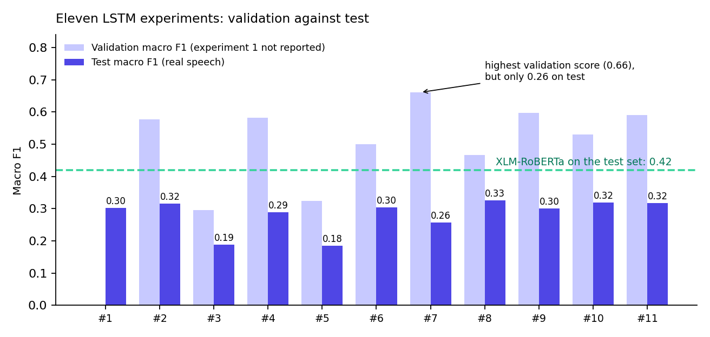

# Bulgarian Speech Emotion Recognition

A pipeline that takes a YouTube link and returns a timestamped table: every Bulgarian sentence, its English translation, and its emotion, one of anger, disgust, fear, happiness, neutral, sadness or surprise. Built by a team of four. The emotions come from a fine-tuned **XLM-RoBERTa** transformer that reads the Bulgarian directly.

The honest headline: emotion in real speech is hard. The final transformer reaches a **macro F1 of 0.42** on our own test set of real spoken Bulgarian. The best LSTM, trained from scratch, reached 0.33, and prompting Llama 3.3 70B reached 0.59 on a separate, easier set. Emotion labels are ambiguous even for people, so the ceiling is low.



## The pipeline

| Step | What happens | Code |
|---|---|---|
| **Video** | Download the audio of a YouTube link | [`pipeline/pipeline_step_1_transcribe.py`](pipeline/pipeline_step_1_transcribe.py) |
| **Transcribe** | Bulgarian speech to text with sentence timestamps (AssemblyAI) | same file |
| **Translate** | Bulgarian to English with a fine-tuned Hugging Face sequence-to-sequence model | [`pipeline/pipeline_step_2_translate.py`](pipeline/pipeline_step_2_translate.py) |
| **Classify** | Seven emotions from the Bulgarian text with XLM-RoBERTa | [`pipeline/pipeline_step_3_classify.py`](pipeline/pipeline_step_3_classify.py) |

[`pipeline/main_pipeline.py`](pipeline/main_pipeline.py) runs the four steps and writes a CSV with the columns `Start Time`, `End Time`, `Sentence`, `Translation` and `Emotion`. For example, "Имаме една хубава, спокойна сутрин." becomes "I have a nice, calm morning." and is labelled happiness.

## Results

| Approach | Macro F1 | Measured on |
|---|---|---|
| **XLM-RoBERTa, fine-tuned** | **0.42** | Test set of real speech |
| Best LSTM (experiment 8) | 0.33 | The same test set |
| Final tuned LSTM (experiment 11) | 0.32 | The same test set |
| Llama 3.3 70B with self-consistency voting | 0.59 | A separate set of 1,005 sentences |

The Llama number is not comparable with the others, because it was measured on a different set. A two-stage cascade (a binary classifier followed by a six-class model) scored slightly above the best LSTM and below the transformer.

## How we got there

| Approach | Outcome |
|---|---|
| **Traditional models** (logistic regression, naive Bayes, SVM) | The baselines. |
| **RNN and LSTM track:** eleven documented experiments | Stuck at about 0.32 on real speech. [Details](docs/lstm-experiments.md), [tuning](docs/hyperparameter-tuning.md). |
| **Context-aware sentence-pair model** | Overfitted. |
| **Continual learner** with pseudo-labelling | Suffered from confirmation bias and overfitted. |
| **Llama prompting** | 0.59 on its own set. [Details](docs/prompt-engineering-llama.md). |
| **Two-stage cascade** | A little better than the best LSTM. |
| **XLM-RoBERTa** | Best result, and the model in the final pipeline. |

The LSTMs scored around 0.6 on validation data and around 0.3 on real speech. The training corpus is translated written text and the test set is spoken Bulgarian, so the validation score said little about the real task. A transformer pre-trained on far more varied text handles that gap better.

## Where the model fails

- It leans towards **neutral**, and slightly towards sadness.
- It classifies **happiness** reliably.
- It struggles with **anger** and with the rarer emotions: **fear, surprise and disgust**.

What the model looks at is shown in [`docs/explainability.md`](docs/explainability.md).

## The human ceiling

Emotion is ambiguous, and annotators often disagree about the label of a sentence. On our own test set, reading a sentence and listening to it gave a different emotion for **32%** of the sentences. That puts a ceiling on any score, so the numbers above should be read against what people would achieve, not against 1.0.

## Data

A 608,540-sentence corpus built from translated and automatically labelled datasets, a 653-sentence test set of real speech annotated by the team, and a 1,005-sentence set for the Llama prompts. None of it is published: see [`data/README.md`](data/README.md).

## Responsible use

Emotion estimated from text is an estimate, not a fact about a person, and it should not be used to make decisions about people. The team considered four questions: working with human emotions, data privacy and consent, fair and responsible use, and transparency and accountability. The pipeline downloads audio from YouTube, which may conflict with YouTube's terms or the creators' rights, so use it only with content you are allowed to process.

## Team and my role

Team of four. I annotated emotions for our test set and contributed to feature extraction. My main focus was modelling: I owned the **RNN and LSTM track** (eleven documented experiments, in `notebooks/02` and `notebooks/03`), and together with a teammate I built the **fine-tuned XLM-RoBERTa transformer**. I also ran the **prompt-engineering track** with Llama models and presented the project. The pipeline code is the team's.

## Repository contents

```
bulgarian-speech-emotion-recognition/
  pipeline/                           the end-to-end pipeline
  notebooks/
    01_nlp_features.ipynb             POS tags, TF-IDF, sentiment, embeddings
    02_lstm_experiments.ipynb         RNN and LSTM baselines
    03_lstm_bpe_focal_iterations.ipynb  BPE, attention and focal-loss LSTMs
    04_prompt_engineering_llama.ipynb Llama prompts, twenty iterations
    05_explainable_ai.ipynb           Gradient x Input, LIME, attention
  docs/                               LSTM experiments, tuning, prompts, explainability
  figures/                            charts
  data/README.md                      how the data was built (not included)
  requirements.txt
```

## Running the pipeline

```
python pipeline/main_pipeline.py --youtube-url "URL" --api-key "ASSEMBLYAI_KEY" \
    --trans-model-dir "./translation_model" --emotion-model-dir "./emotion_model" \
    --output-csv "output.csv"
```

You need an AssemblyAI key and the two trained models, which are not included. Install the dependencies with `pip install -r requirements.txt`.

## Not included

The data, the trained models, and the code that fine-tuned the XLM-RoBERTa and translation models. The notebooks here cover the features, the LSTM track, the prompt work and the explanations.

## More

[Full case study on my portfolio](https://rayakichukova.com/project-bulgarian-emotion.html). Built in 2025 as a second-year university project. The code is shared for review; please ask before reusing it.
