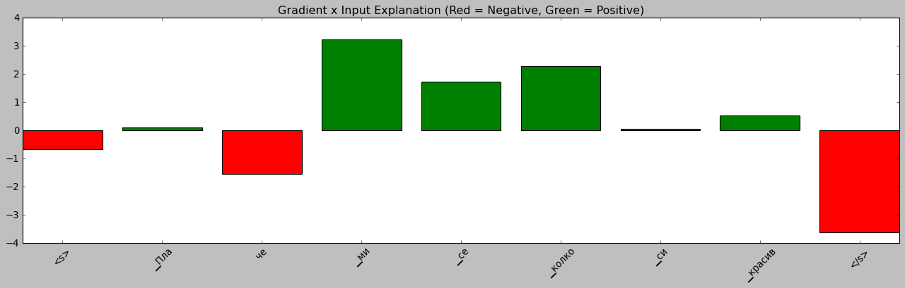
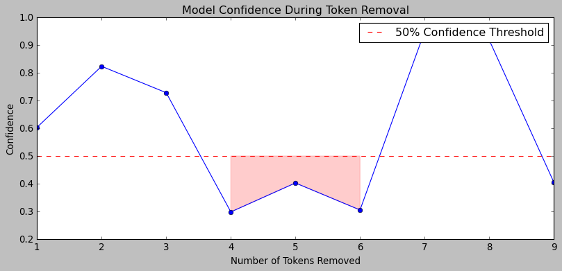
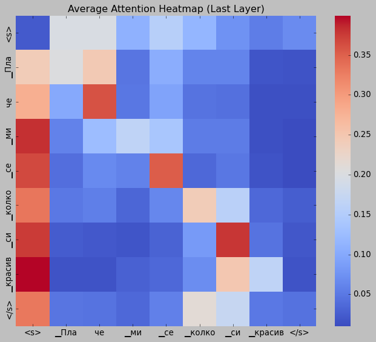

# Explainability

What does the fine-tuned XLM-RoBERTa model look at? The notebook [`05_explainable_ai.ipynb`](../notebooks/05_explainable_ai.ipynb) opens the model with several methods and applies them to one sentence, "Плаче ми се колко си красив" ("I feel like crying because of how beautiful you are").

## Methods

| Method | What it shows |
|---|---|
| **Gradient x Input** | A relevance score per token: how much each token pushes the prediction towards or away from the predicted emotion. Improved with conservative layer-wise relevance propagation through the attention layers. |
| **Perturbation** | Removes the most relevant tokens one by one and watches the model's confidence. |
| **Attention heatmap** | Average attention of the last layer between all token pairs. |
| **LIME** | Perturbs the sentence locally and fits a simple model, to see which words drive each class. |
| **SHAP** | The model is wrapped as a function from raw text to class scores so SHAP can use it. |

## What it showed

- **Gradient x Input:** the words of the emotional phrase "ми се колко" have the strongest positive influence, while the special start and end tokens are negative.
- **LIME:** the model predicts sadness with 87% confidence, and "Плаче" (crying) is by far the strongest reason. "колко си красив" (how beautiful you are) adds a little, because the sentence reads as crying from being moved.
- **Perturbation:** removing the fourth to sixth most important tokens pushed the confidence below 50%, which fits the idea that those tokens matter. The curve is not smooth, though, and confidence rises again at later steps, so this is supporting evidence and not proof.

- **Attention heatmap:** hard to read. Attention is spread over many layers and heads, and the start token collects most of it, so I would not treat it as an explanation on its own.

## Limits

This is one sentence, chosen to illustrate the methods. It shows that the model uses meaningful words in this case, but it is not a systematic evaluation, and the model's known weaknesses (a pull towards neutral, and trouble with anger, fear, surprise and disgust) are not visible in it.

Back to the [project README](../README.md).
