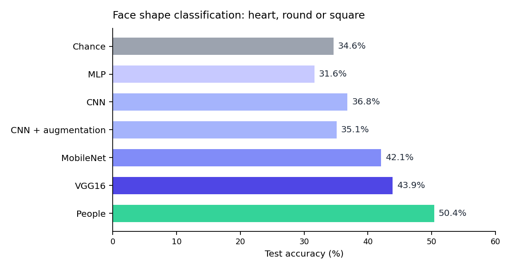

# Face Shape Classification

A classifier that recognises three face shapes (heart, round and square) from a photo, built for small online eyewear retailers, plus a clickable prototype of the shopping experience around it.

The best model, VGG16 transfer learning, reaches **43.9%** test accuracy. That is above chance (34.6%) and below what people achieve on the same task (50.4%). This repository documents how I got there, where the model fails and what I would do next.



## Results

| Model | Test accuracy |
|---|---|
| Chance (class proportions) | 34.6% |
| Multilayer perceptron | 31.6% |
| CNN | 36.8% |
| CNN with data augmentation | 35.1% |
| MobileNet (transfer learning) | 42.1% |
| **VGG16 (transfer learning)** | **43.9%** |
| People (5 participants, 50 answers per class) | 50.4% |

The test set is 10% of the data, about 57 images, so each figure carries a wide margin of error. The honest reading is that transfer learning clearly helps, and that the task is hard even for people.

## Dataset

- 564 images in 3 classes: heart (195), round (180) and square (189).
- Collected from the web by searching for each face shape, with a small number of generated images. Sketched or drawn overlays and images that were not clearly frontal were removed, and everything was converted to JPG and resized to 128 x 128 with padding.
- Split 80% training, 10% validation and 10% test.
- **The images are not included**, because they are photographs of real people. See [`data/README.md`](data/README.md).

## Models

| Iteration | Approach |
|---|---|
| Baseline | Multilayer perceptron: flatten, dense 128, dense 32, softmax. Early stopping, batch size 16. |
| 1 | Small CNN with max-pooling, batch normalisation, dropout and global average pooling. Up to 100 epochs, batch size 32, early stopping on validation loss. |
| 2 | The same CNN with random zoom and random rotation layers at the input. Other augmentations were tested and dropped, because users are expected to take frontal photos. |
| 3 | MobileNet with a frozen ImageNet base, global average pooling and a new classification head, learning rate 1e-5. |
| 4 | VGG16 with a frozen ImageNet base and a new classification head, learning rate 1e-5. |

All the code is in [`notebooks/face_shape_classification.ipynb`](notebooks/face_shape_classification.ipynb), with the learning curves and confusion matrices for every iteration in [`figures/`](figures/).

## Where the model fails

I looked at every misclassified test image and sorted the errors into categories. One image can fall into more than one category, so the percentages are shares of the 66 category assignments.

| Error type | Count | Share |
|---|---|---|
| Similar shapes (soft jawlines, wide cheeks, tapered chins) | 19 | 28.8% |
| Pose and orientation | 17 | 25.8% |
| Hair, makeup and other obstructions | 10 | 15.2% |
| Facial expression | 9 | 13.6% |
| Image quality and noise | 6 | 9.1% |
| Lighting and exposure | 5 | 7.6% |

The first CNN also leans heavily towards one class, which the confusion matrices show.

## Explainability

I used Grad-CAM (through the Xplique library) on the first CNN to see where the model looks. Even at around 37% accuracy, the heatmaps concentrate on the jawline, cheeks and forehead, which are the regions that matter for face shape. The model looks in the right places but is not confident, which matches its accuracy. Details in [`docs/responsible-ai.md`](docs/responsible-ai.md).

## From model to experience

The model sits inside a prototype for an online eyewear shop: upload a photo, see your face shape and browse frame recommendations.

- **Prototype:** [clickable Figma prototype](https://www.figma.com/proto/24rY6Z9phTcSL2BrlVkAfO/Wireframe-2?page-id=2007%3A26&node-id=2007-27&p=f&scaling=scale-down&content-scaling=fixed&starting-point-node-id=2007%3A27)
- **Think-aloud study** with three participants: the interface was easy to navigate, and the personalised frame recommendations were the most valued feature. Participants asked for explanations of why a frame suits or does not suit their face shape, so I added them.
- **A/B test** of two layouts, with frames grouped by category or not: no significant difference on any survey question (all p-values above 0.05).

Details in [`docs/human-centered-design.md`](docs/human-centered-design.md).

## Bias and fairness

A search for "round face shape" returned 80 images of Caucasian people, 40 of Asian people and 26 of African-American people, and none of Latino-American people. A model trained on data like this can misread under-represented groups. I propose balancing the dataset and using "fairness through awareness", which takes ethnicity into account instead of ignoring it. Details in [`docs/responsible-ai.md`](docs/responsible-ai.md).

## What I would do next

- Detect facial landmarks (jawline, cheekbones, forehead) and classify from geometry, so the model relies on shape and not on hair or background.
- Align faces and curate a larger, balanced, front-facing dataset with varied lighting.
- Handle uncertain cases, because many faces sit between two shapes.
- Evaluate fairness across groups before any real use.

## Repository contents

```
face-shape-classification/
  notebooks/face_shape_classification.ipynb   all models, training and error analysis
  figures/                                    results chart, learning curves, confusion matrices
  docs/
    business-understanding.md                 market research, stakeholders, problem definition
    human-centered-design.md                  prototype, think-aloud study, A/B test
    responsible-ai.md                         bias, fairness and Grad-CAM
  data/README.md                              how the dataset was built (images not included)
  requirements.txt
```

## Running the notebook

1. Install the dependencies: `pip install -r requirements.txt`
2. Rebuild a dataset with the layout described in [`data/README.md`](data/README.md). The notebook expects `Dataset_Images/Resized images_extra/` with one folder per class (`Heart JPG`, `Round JPG`, `Square JPG`).
3. Open the notebook and run it from the top.

The notebook was written for a university course and keeps its original structure, so some folder names refer to that setup.

## Not included

The dataset, the trained models, the interview recordings and transcripts, and the original course reports and slides are not published. They contain photographs and personal data of real people. The write-ups in `docs/` are anonymised summaries.

## More

[Full case study on my portfolio](https://rayakichukova.com/project-face-shape.html). Built in 2025 as a first-year university project. The code is shared for review; please ask before reusing it.
