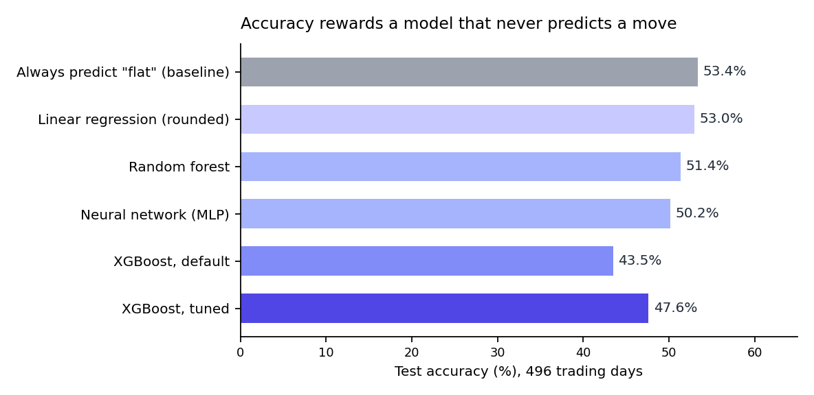
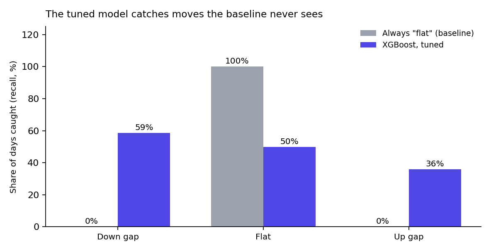
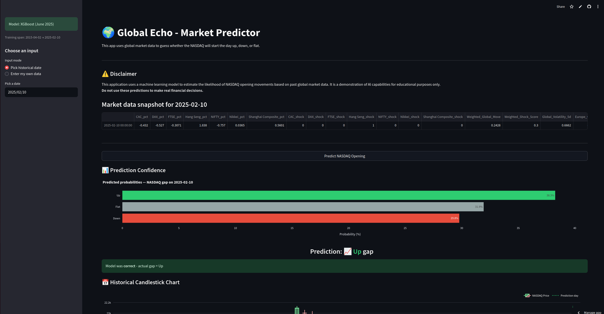
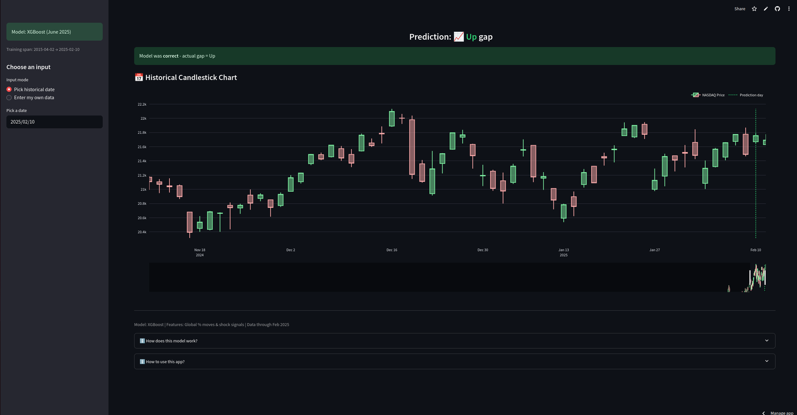

# NASDAQ Opening Gap Forecast

A model that reads the overnight moves of seven Asian and European stock indices to forecast whether the NASDAQ-100 will open **up, down or flat**, built by a team of four for a financial-data company, Move Tickers. The project covered the whole chain: proposal, database, data pipeline, models, a legal assessment, a packaged and tested Python project, a dashboard and a final presentation to the client.

The honest headline: the signal is weak. A model that always predicts "flat" scores 53.4% accuracy and tells you nothing. The tuned XGBoost scores lower on accuracy (47.6%) but is the model that actually catches moves: it identifies **59% of down-gap days**, against 0% for the baseline, with the best macro ROC-AUC of the models tested (0.634). The proposal's targets (ROC-AUC 0.70, F1 0.60) were not reached.



## What the project contained

| Part | What it is | Where |
|---|---|---|
| **Proposal** | Problem, objectives, planned data, method and timeline, and how the delivered project differs | [`docs/project-proposal.md`](docs/project-proposal.md) |
| **Database** | PostgreSQL schema that every model read from and wrote results to | [`database/`](database/) |
| **Data pipeline** | Cleaning, time-zone alignment, percentage moves, shock flags and engineered features | [`notebooks/model_development.ipynb`](notebooks/model_development.ipynb) |
| **Models** | Baseline, linear regression, random forest, XGBoost and a neural network, with tuning | [`notebooks/model_development.ipynb`](notebooks/model_development.ipynb) |
| **Evaluation** | Time-series validation, class-level metrics and a baseline comparison | [`results/test_set_metrics.md`](results/test_set_metrics.md) |
| **Legal assessment** | EU AI Act risk tier and GDPR check | [`docs/legal-risk-assessment.md`](docs/legal-risk-assessment.md) |
| **MLOps** | Poetry packaging, linting, unit tests with 82% coverage and documentation | [`docs/mlops-and-packaging.md`](docs/mlops-and-packaging.md) |
| **Dashboard** | Streamlit app "Global Echo" | [`app/app.py`](app/app.py) |
| **Client presentation** | Final presentation of the results to Move Tickers on 20 June 2025 | not included |

## The question

Major markets in Asia and Europe trade while New York is closed. Can their moves signal how the NASDAQ-100 will open, so that users know what to expect at the opening bell?

## Approach

**Data.** Ten years of daily prices (February 2015 to February 2025) for seven indices (Nikkei 225, Hang Seng, Shanghai Composite, NIFTY 50, DAX 40, CAC 40 and FTSE 100) and for the NASDAQ-100, stored in a PostgreSQL database.

**Label.** The opening gap is the open against the previous close. A gap of +0.4% or more is **Up**, -0.4% or less is **Down**, and anything in between is **Flat**. About 53% of days are flat, so the classes are imbalanced.

**Features.**
- Daily percentage change of each index.
- A "shock" flag when a move is larger than 1.5 times the index's 30-day volatility.
- A weighted global move and weighted shock score across the indices.
- Five-day volatility of the global move, and the gap between European and Asian moves.
- European markets are still open when New York opens, so their previous close is used. That is what a trader would know at the bell, and it avoids looking into the future.

**Validation.** The last 20% of days (496 trading days, February 2023 to February 2025) form the test set, in chronological order. Tuning used time-series cross-validation, which keeps the order of days and avoids the look-ahead bias that random folds would introduce.

**Models.** A baseline that always predicts the most common class, linear regression with rounded output, random forest, XGBoost and a small neural network. Class imbalance was handled with class weights. XGBoost was tuned with a grid search on macro ROC-AUC, and the chosen configuration is a shallow, heavily regularised model (depth 3, learning rate 0.005, 100 trees).

## Results

| Model | Test accuracy |
|---|---|
| Always predict "flat" (baseline) | 53.4% |
| Linear regression (rounded) | 53.0% |
| Random forest | 51.4% |
| Neural network (MLP) | 50.2% |
| XGBoost, default | 43.5% |
| **XGBoost, tuned** | **47.6%** |

Accuracy is the wrong yardstick here, because the baseline wins it by never predicting a move. The tuned XGBoost has a macro F1 of 0.45 and a macro ROC-AUC of 0.634, against 0.629 for the default model.



| Class | Precision | Recall | F1 |
|---|---|---|---|
| Down gap | 0.34 | 0.59 | 0.43 |
| Flat | 0.61 | 0.50 | 0.55 |
| Up gap | 0.41 | 0.36 | 0.38 |

More in [`results/test_set_metrics.md`](results/test_set_metrics.md). The model is a demonstration, not a trading tool, and the dashboard says so.

## Dashboard

The Streamlit app "Global Echo" lets you pick a historical date or enter your own market moves. It shows the day's index moves, the predicted probabilities for up, down and flat, whether the model was right, and a candlestick chart of the NASDAQ-100 around that day. It was written mainly by one teammate and me, and I verified it.





## Database

I designed and built the PostgreSQL database: a dimensional design draft, and the schema the models read from, with primary keys, non-negative `CHECK` constraints and indexes. Details and both scripts in [`database/`](database/).

## MLOps

The team packaged the project with Poetry, added logging, black and flake8, wrote unit tests (82% coverage) and documented it. I verified this part. Details in [`docs/mlops-and-packaging.md`](docs/mlops-and-packaging.md).

## Legal and compliance

The team classified the system under the EU AI Act as limited risk, which means transparency duties and good documentation, and checked GDPR (it uses only public market prices). Summary in [`docs/legal-risk-assessment.md`](docs/legal-risk-assessment.md).

## Team and my role

Team of four.

I was the **team lead**, coordinating planning and the project board, and I owned the data foundation: I designed and built the PostgreSQL database that every model read from and wrote its results back to. I also contributed to model development, modular code and unit tests, verified the dashboard and the MLOps work, and led the final presentation to the client.

## What I would do next

- **Use Europe's live session.** Prices from just before 9:30 in New York would add the most recent information without leaking the future.
- **Add pre-market signals.** NASDAQ futures, the VIX and the dollar-yen rate react overnight and are likely stronger predictors than a weighted average of indices.
- **Judge it like a trader would.** Backtest a simple strategy with transaction costs and tune the decision threshold per class, instead of relying on accuracy.
- **Retrain as markets change.** A walk-forward scheme would handle shifts like 2020 and 2022 better than one fixed model.
- **Go further with the proposal's ideas:** segment the NASDAQ-100 by sector, add news sentiment, automate retraining and backtesting, and offer premium features such as alerts.

## Repository contents

```
nasdaq-opening-gap-forecast/
  notebooks/model_development.ipynb    preprocessing, features, models, tuning, evaluation
  app/app.py                           Streamlit dashboard
  database/                            design draft, project schema and notes
  docs/
    project-proposal.md                proposal and planned against delivered
    mlops-and-packaging.md             packaging, practices and test coverage
    legal-risk-assessment.md           EU AI Act and GDPR assessment
  results/test_set_metrics.md          test-set metrics
  figures/                             charts and dashboard screenshots
  data/README.md                       expected data files (not included)
  requirements.txt
```

## Running the notebook and the dashboard

1. `pip install -r requirements.txt`
2. Add the eight price files described in [`data/README.md`](data/README.md) under `Data/`.
3. Open the notebook and run it from the top. It produces the features, the models and the results.
4. The notebook's last cells save everything the dashboard needs: `xgb_best_model.pkl`, `best_model.pkl` (the label encoder), `Features.csv` and `Target.csv`. Put them next to `app/app.py`, add `Data/NASDAQ100.csv`, and run `streamlit run app/app.py`.

## Not included

The price data, the trained models, the database server and its credentials, the team's packaged code and tests, the proposal and presentation documents, and the university reports. The database server belongs to the university.

## More

[Full case study on my portfolio](https://rayakichukova.com/project-nasdaq-gap.html). Built in 2025 as a first-year university project. The code is shared for review; please ask before reusing it.
