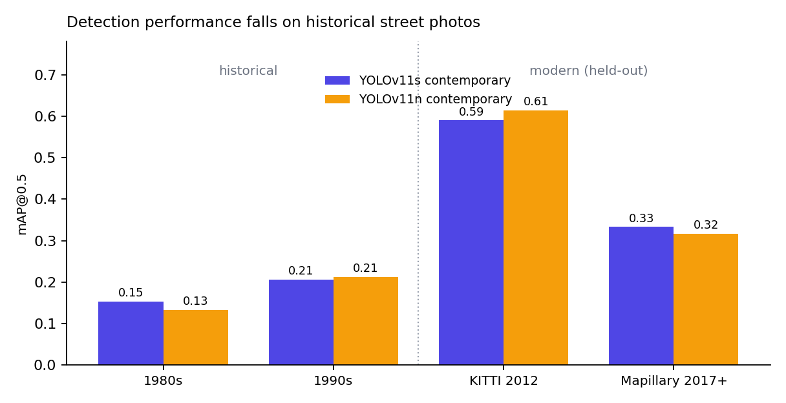
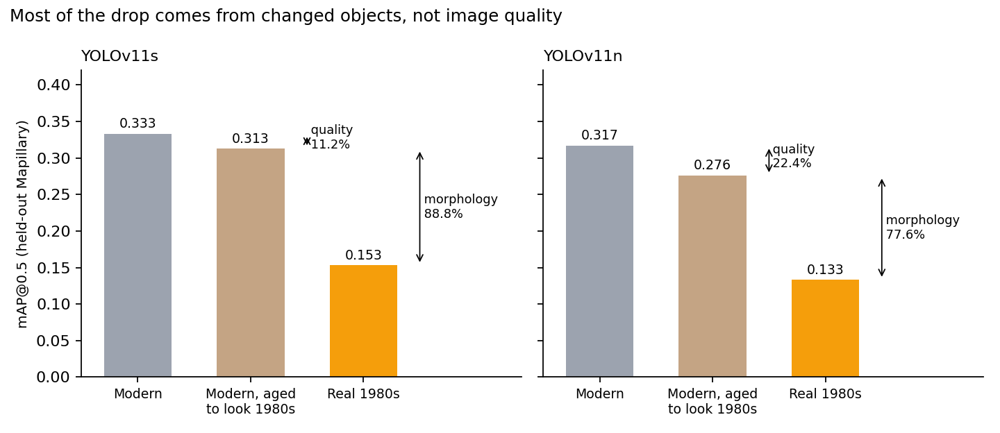

# Temporal Degradation in Object Detection

How much does a modern object detector degrade on street photos from the 1980s and 1990s, and is the cause worse image quality or objects that simply looked different? A research project across four datasets spanning 35 years, two YOLOv11 sizes and four controlled experiments.

**Result.** Scored on images they never saw, contemporary-trained detectors lose **61 to 63% of their mAP** on historical street photos. Image quality explains only **11 to 22%** of the drop, so the changed look of cars, buildings and people explains the rest. At the default confidence threshold the failure is silent: the model misses objects instead of mislabelling them.



## A correction worth knowing about

My first evaluation scored the modern benchmarks (KITTI and Mapillary) on every image, including about 90% that the models had trained on or used to choose their best checkpoint. That flattered the modern scores and made the drop look larger (about 70 to 72%). I found this in review, rebuilt the evaluation on held-out images and re-ran every experiment. Every number in this repository is the corrected one. The conclusions held, and the image-quality share turned out smaller than first reported. Details in [`docs/evaluation-protocol.md`](docs/evaluation-protocol.md).

## Research question

To what extent do morphological evolution and digital data degradation contribute to the performance decay of modern object detection models in historical urban environments?

| Sub-question | Experiment |
|---|---|
| **SQ1** Morphology or image quality? | Experiment 4: synthetically age modern photos and compare |
| **SQ2** Can resolution normalisation close the gap? | Experiment 3: score at 320, 640 and 1280 pixels |
| **SQ3** Does scene composition shift where errors fall? | Edge error rate per period |
| **SQ4** Which classes fail, and how? | Per-class AP and error type |

## Data and models

Four datasets, unified into five classes (Building, Car, Truck, Pedestrian, Cyclist): 1980s New York archive photos, 1990s Los Angeles and London photos (greyscale), KITTI 2012 dashcam images and Mapillary 2017+ crowdsourced images. I annotated the historical images and the KITTI buildings myself. Details and licences in [`data/README.md`](data/README.md). None of the images are published.

Four YOLOv11 models were fine-tuned, from COCO weights: nano and small, each on contemporary data only (KITTI and Mapillary) or on all four periods. The two **contemporary-only** models are the instruments for measuring degradation, because a model trained on historical images cannot measure how a modern one copes with them. The multi-era models are a secondary finding.

## Findings

| | YOLOv11s | YOLOv11n |
|---|---|---|
| Relative mAP drop, historical against modern | 61.2% | 62.9% |
| Gap (modern minus historical mAP) at 320, 640 and 1280 px | 0.142, 0.282, 0.323 | 0.148, 0.293, 0.310 |
| Share of the drop from image quality | 11.2% | 22.4% |
| Share from changed objects (morphology) | 88.8% | 77.6% |
| Errors whose box reaches the outer 15% of the frame, historical against modern | 62.8% against 32.7% | 60.8% against 32.7% |

- **Morphology dominates.** Ageing modern photos to look like the 1980s costs only 6% (small) and 13% (nano) of the mAP, while real 1980s photos cost 54% and 58%.
- **Higher resolution does not help.** Upscaling the roughly 150-pixel 1980s images adds noise, not detail, and the gap widened by 109 to 128%.
- **Historical errors reach the frame edges about twice as often.** About 63% involve a box that reaches the outer 15% of the frame, against 33% on modern images. Measured by box centre, errors sit toward the middle of every dataset (30 to 38% historical, 20 to 25% modern, against about 51% if spread evenly), so this reflects how far boxes stretch, not errors piling up at the borders. I have not tested why.
- **Truck and Cyclist score zero** on historical data under every measure. The historical sets hold only 7 trucks, so that result is thin, but all 121 historical cyclists are missed, which is a real failure and not a scarcity artefact.
- **Localisation failure dominates.** At the default confidence threshold of 0.25 the model fires rarely and misses most objects: precision stays high while recall collapses.
- **Cars are a calibration problem more than a recognition one.** Car AP@0.5 stays at about 0.50 on historical photos (about 0.75 on modern ones), so the model still ranks real cars sensibly, but at the default threshold it finds only 2 of 679 cars in the 1980s and 142 of 993 in the 1990s. By AP@0.5 Pedestrian loses about 75%, Building 35 to 46% and Car 33 to 39%.

| Hypothesis | Verdict |
|---|---|
| H1 F1 is lower on historical data | Supported (p = 0.0008 and 0.0041) |
| H2 Vehicles and pedestrians degrade most | Not clearly supported: by AP@0.5 Car and Building degrade least (33 to 46%) |
| H3 Resolution normalisation narrows the gap | **Refuted**: it widens it |
| H4 Historical errors concentrate at the edges | Partly supported: they reach the edges twice as often (63% against 32%, p < 0.0001), but by box centre they sit toward the middle |
| H5 Recognition failure dominates | **Refuted**: localisation failure dominates |

Four of the five verdicts are the same for both model sizes, and H2 is inconclusive for both. Full tables in [`results/summary.md`](results/summary.md) and a write-up in [`docs/research-summary.md`](docs/research-summary.md).



## Limitations

- **The modern benchmarks are small:** 30 held-out images each for KITTI and Mapillary, so modern scores and per-class results are noisy.
- **The 1990s images are greyscale**, which mixes temporal shift with the loss of colour.
- **The 1980s images are about 150 pixels across**, a resolution floor that experiment 3 cannot fully separate from morphology.
- **The ageing pipeline cannot reproduce historical sharpness**, so the quality share is a lower bound and the morphology share an upper bound.
- **One annotator** labelled the historical images, and the four datasets come from different cities.
- **One detector family** (YOLOv11) was tested.
- **The two edge measures disagree.** An error counts as an edge error if its box reaches the outer 15% of the frame, which large boxes do almost by construction. By box centre the picture is different (see above).
- **Per-class AP in SQ4 is approximate.** It is an 11-point interpolation of detections at confidence 0.25, comparable across periods but not with the Ultralytics mAP used elsewhere.

## Repository contents

```
temporal-degradation-object-detection/
  notebooks/research_notebook.ipynb    all experiments, with outputs
  src/preprocessing.py                 builds the unified five-class dataset
  src/utils.py                         conversion, cropping, merging and unifying functions
  docs/
    research-summary.md                question, hypotheses, results, limits
    evaluation-protocol.md             the held-out evaluation and the correction
    data-and-ethics.md                 datasets, GDPR assessment, AI tools
  results/summary.md                   every result table
  figures/                             charts
  data/README.md                       datasets and how to rebuild (images not included)
  requirements.txt
```

## Running it

1. `pip install -r requirements.txt`
2. Obtain the four datasets (see `data/README.md`) and set `PROJECT_DIR` to the folder that holds `Data/`.
3. `python src/preprocessing.py` builds the unified dataset.
4. Run the notebook from the top. It trains the four models, builds the held-out evaluation sets and runs every experiment.

## Not included

The images, my annotation files and the trained weights. The source datasets carry licences that restrict redistribution, and the images may incidentally show faces and number plates.

## AI tools

Claude (Anthropic) was used for code review and organisation, LaTeX formatting and document structure, and NotebookLM (Google) for citation extraction. The research design, annotation, analysis and conclusions are my own.

## More

[Full case study on my portfolio](https://rayakichukova.com/project-temporal-degradation.html). Built in 2026 as a second-year university research project, solo. The code is shared for review; please ask before reusing it.
