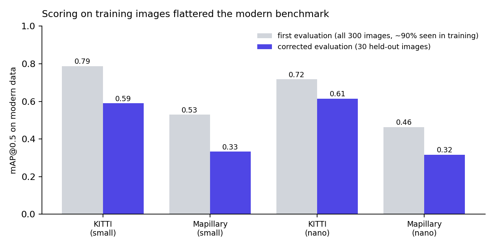

# Evaluation protocol and a correction

Every number in this repository comes from images the evaluated model never saw.

## The protocol

- **Contemporary-only models** (the primary models): KITTI and Mapillary are scored on the held-out 10% test split, about 30 images each. The 1980s and 1990s images were never part of their training, so all of them are used (302 and 304 images).
- **Multi-era models:** they trained on all four periods, so each period is scored on their own held-out test split (31, 31, 30 and 30 images).
- Each dataset was split 80/10/10 (training, validation, test) with a fixed seed. The validation split chose the best checkpoint, and the test split was used only for evaluation.

## What went wrong the first time

The first version scored each period on every image in its folder. For the contemporary-only models, that included the 80% used for training and the 10% used to pick the checkpoint, so KITTI and Mapillary scores rewarded memorised images. The 1980s and 1990s scores were never affected, because those images were never in training. The multi-era comparisons were affected in all four periods.

I found the problem in review, rebuilt the evaluation sets and re-ran every experiment. The notebook now builds the held-out sets in a dedicated cell and every evaluation reads them.

## What changed

| | First evaluation | Corrected |
|---|---|---|
| Modern mAP, YOLOv11s (KITTI, Mapillary) | 0.787, 0.529 | 0.590, 0.333 |
| Modern mAP, YOLOv11n (KITTI, Mapillary) | 0.717, 0.463 | 0.614, 0.317 |
| Relative mAP drop (small, nano) | about 72%, 70% | 61.2%, 62.9% |
| Resolution gap growth, 320 to 1280 px (small, nano) | 54%, 49% | 128%, 109% |
| Share of the drop from image quality (small, nano) | 40.8%, 32.1% | 11.2%, 22.4% |
| Share from morphology (small, nano) | 59.2%, 67.9% | 88.8%, 77.6% |
| Edge error gap (small, nano) | 33.5, 31.6 points | 30.2, 28.1 points |

The 1980s scores did not change, the 1990s scores moved by only 0.005 to 0.013, and all five hypothesis verdicts are the same. The image-quality share fell because the "original" Mapillary images in the ageing experiment had also been seen in training, which exaggerated how much ageing them cost.

Two claims did not survive. Multi-era training no longer appears to cost modern performance (the first comparison, 0.787 against 0.689, was in-sample), and the small multi-era model no longer trails the nano one on historical data.

## What remains uncertain

Thirty modern images per dataset is a small sample. The held-out sets of the contemporary-only and multi-era models are different images, so their modern scores cannot be compared directly. A larger shared held-out set, for example from a 60/20/20 split, is the first improvement I would make.

Back to the [project README](../README.md).
